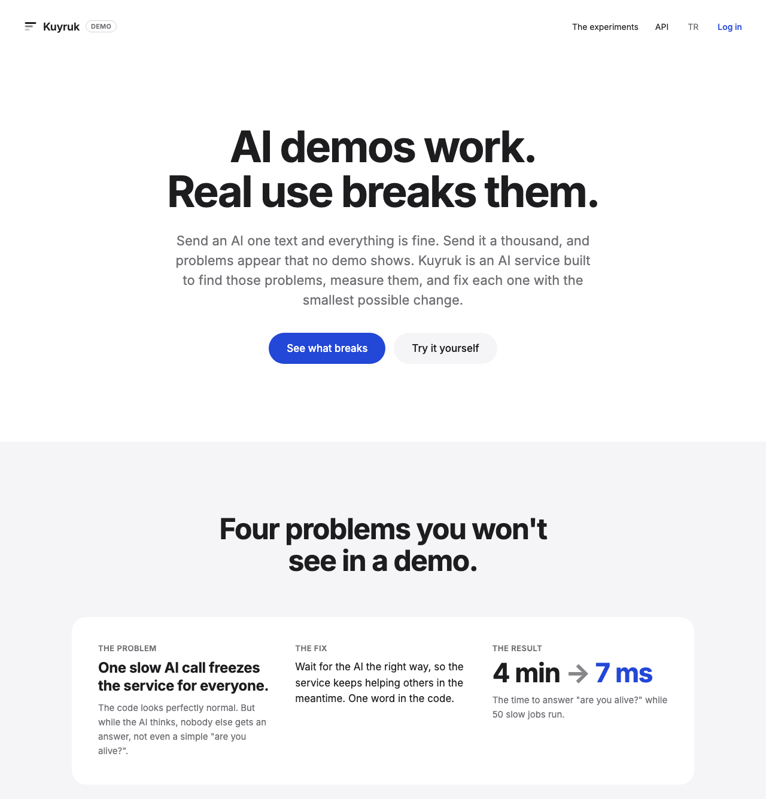
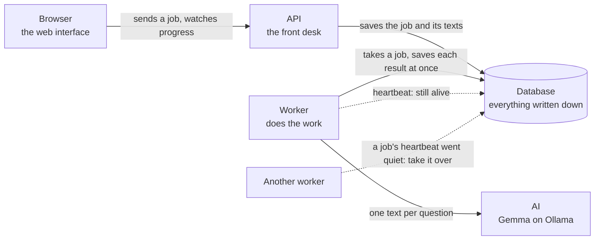
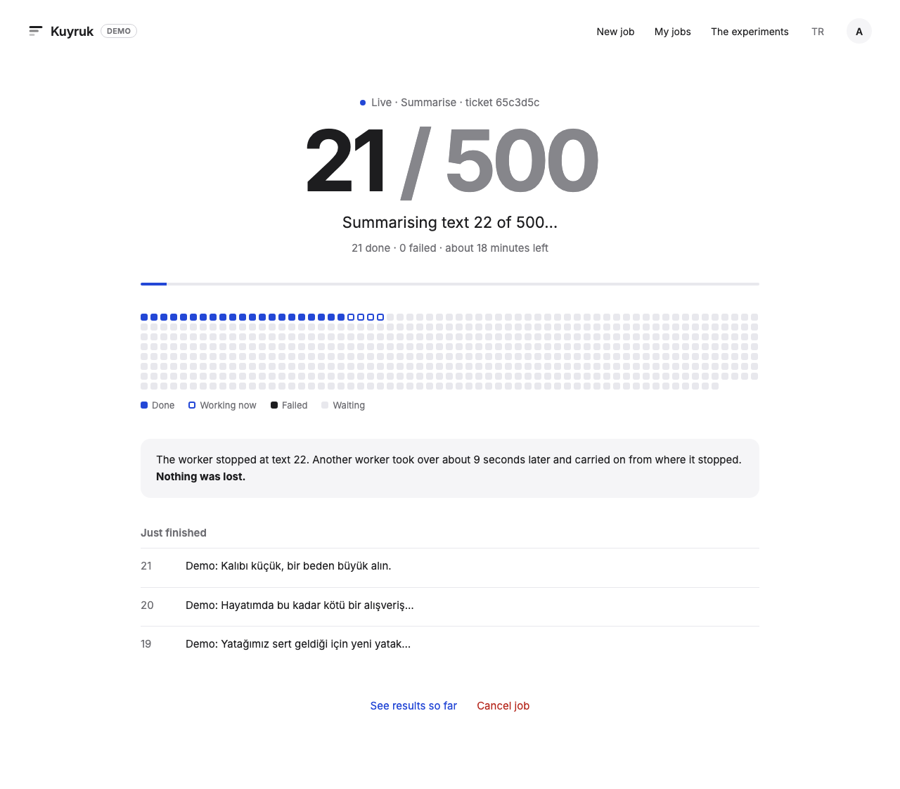
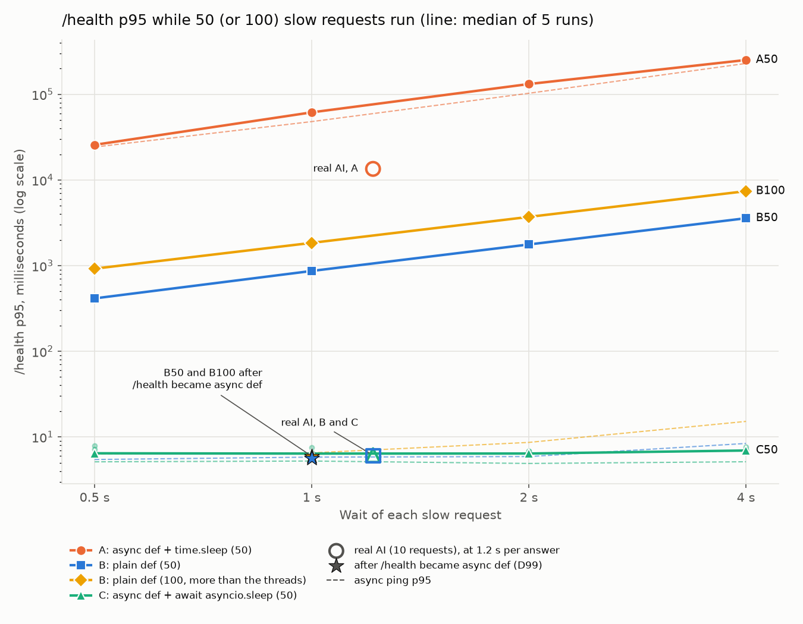
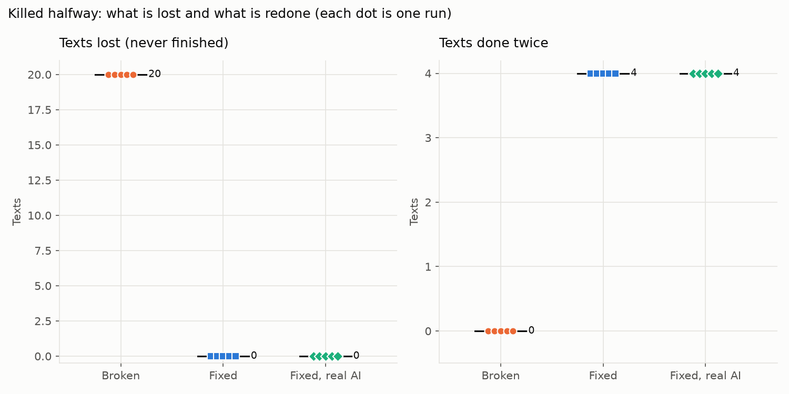
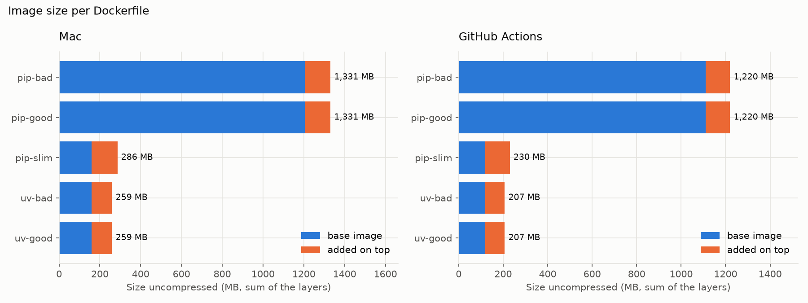
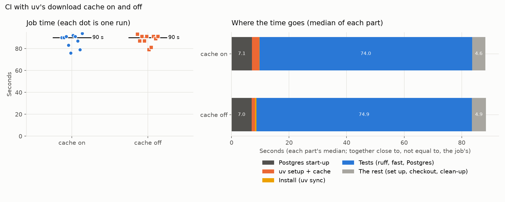
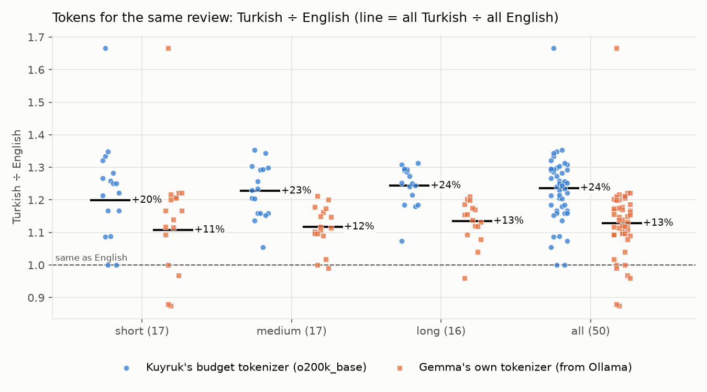
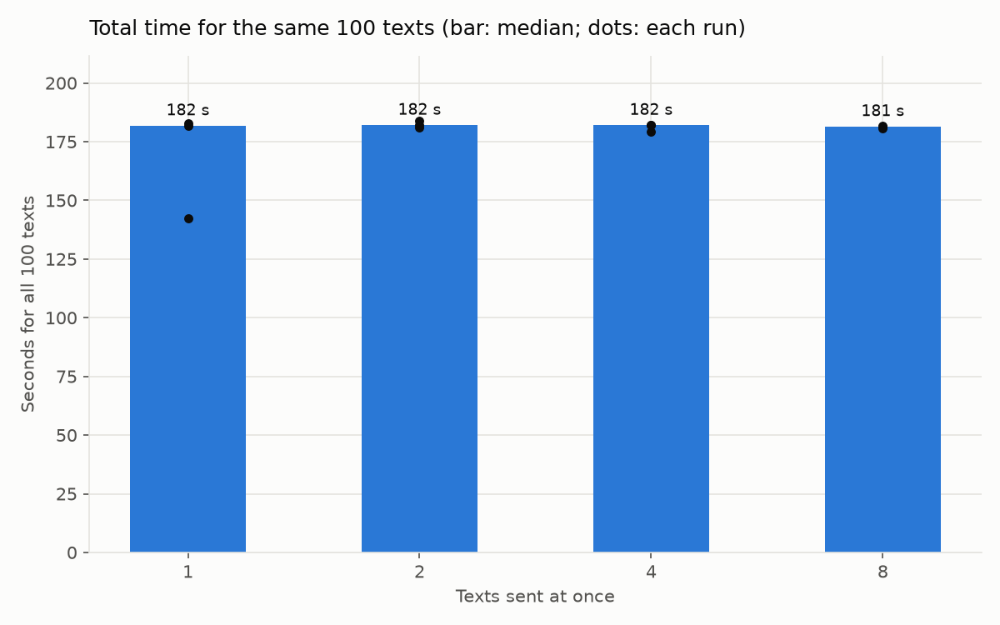
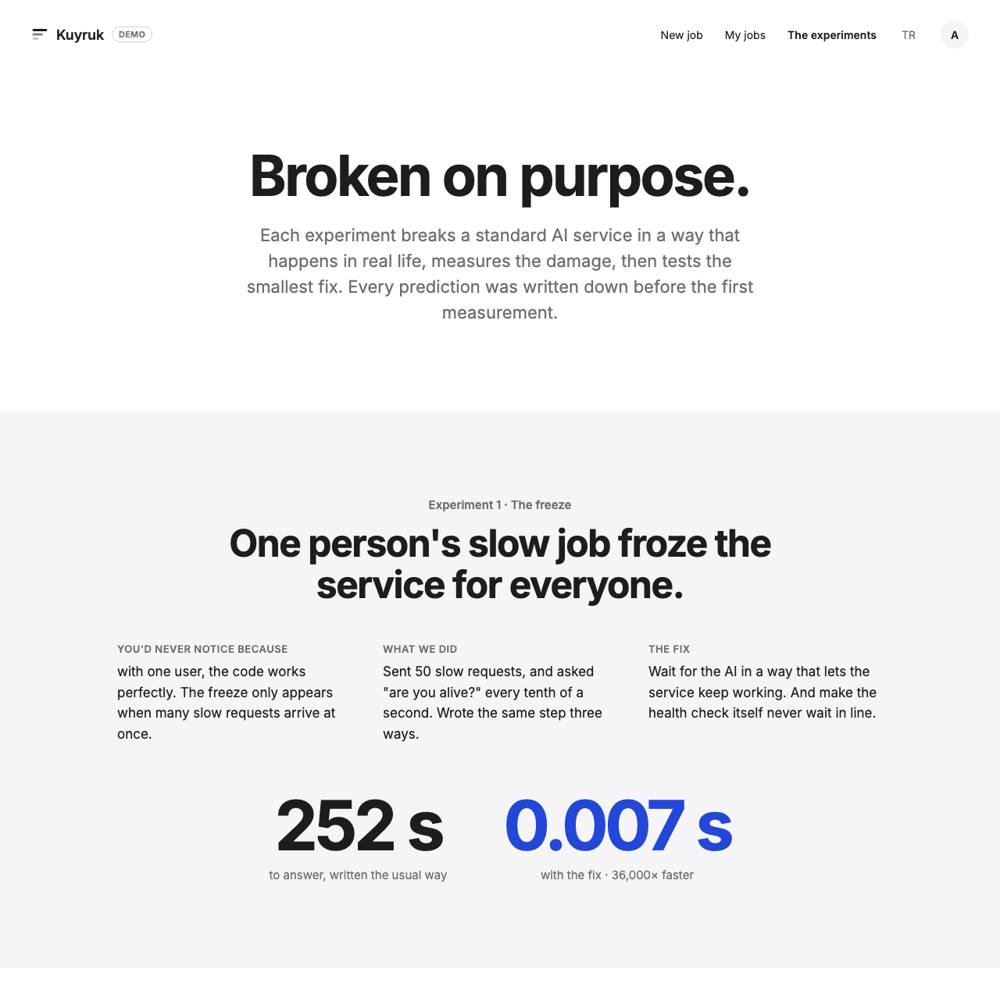

# Kuyruk

**Kuyruk** (Turkish for "queue") is a small service that sends big piles of Turkish texts to an AI without losing any of them. It comes with four experiments. Each one finds where the usual way of building such a service breaks, and measures the smallest fix.

<!-- 18b: the GIF goes here (a few seconds of a job running, crashing and recovering). -->
*A short GIF of Kuyruk at work is coming soon.*

<!-- 18b: the walkthrough video goes here (2 to 3 minutes: the full flow, The experiments, the crash button, the real AI). -->
*A walkthrough video is coming soon.*

## What it does, in plain words

Sending one text to an AI is easy. Sending a thousand is where things go wrong. The AI is slow, computers crash, and every text costs money.

Kuyruk takes a **job**, which is a pile of up to 1,000<!--s:max_texts_per_job--> **texts** (customer reviews, for example). You get a **ticket** straight away and can close the page. Kuyruk then works through the texts in the background. It can clean them, count what they would cost, or ask an AI to summarise each one in a Turkish sentence. You come back later and collect the results.

Building that is ordinary work. The interesting part is the four experiments. Each one takes a mistake that looks perfectly normal in code, shows what it breaks, and measures the smallest change that fixes it.



## How it fits together

Kuyruk is a few separate programs that talk to each other. The **API** is the front desk. The web pages and other programs send it jobs and ask it questions. The **database** is where everything is written down. The **worker** is a separate program that does the actual work, one job at a time. The **AI** is Gemma, a language model from Google, running on the computer through a program called Ollama.



The dotted lines are the safety net. While the worker works, it writes a small "still alive" note to the database every few seconds. That note is called a **heartbeat**. If a worker crashes, its heartbeat goes quiet. Another worker notices, takes the job over and carries on from the first unfinished text. Nothing that was already finished is lost.



## Run it yourself

You don't need to know how to program. You will copy a few commands into a window and press Enter. The whole thing runs on your own computer, and nothing is sent anywhere.

Kuyruk starts in **demo mode**. That means it uses a pretend AI that answers with the same waiting times the real one had when I measured it. So you don't need to install any AI, and everything works straight away.

### 1. Install Docker Desktop

**Docker** is a free program that runs other programs in sealed boxes called **containers**, so they work the same on every computer. Kuyruk needs it.

Go to [docker.com/products/docker-desktop](https://www.docker.com/products/docker-desktop/) and download Docker Desktop for your computer.

- **On a Mac**, there are two downloads, one for Apple chip and one for Intel chip. To find out which one you have, click the Apple menu in the top left corner of the screen and choose **About This Mac**. If the line called **Chip** says Apple, take the Apple chip download. If there is a line called **Processor** that says Intel, take the Intel chip download. Open the file you downloaded and drag Docker into your Applications folder.
- **On Windows**, run the installer and keep the suggested options. Docker Desktop may ask you to turn on **WSL 2** (a part of Windows that Docker needs) and to restart your computer. Say yes and restart.

Open Docker Desktop. The first time, it asks you to accept its terms. You can skip signing in.

**How to tell it is running.** A small whale icon appears at the top of your screen on a Mac, or at the bottom right on Windows. In the Docker Desktop window, the bottom left corner says **Engine running** in green. Leave Docker Desktop open while you use Kuyruk.

### 2. Get the code

Pick one of these two ways.

**The easy way is a ZIP file.** At the top of this page on GitHub, click the green **Code** button, then **Download ZIP**. Find the file in your Downloads folder and open it (double-click on a Mac, or right-click and choose **Extract All** on Windows). You now have a folder called `kuyruk-main`. Inside it, possibly one level further down, is a file called `compose.yaml`. The folder that holds that file is the one you need.

**The developer way is git.** If you already use git, run this, then use the new `kuyruk` folder:

```
git clone https://github.com/adarpalaoglu/kuyruk.git
```

### 3. Open a terminal in that folder

A **terminal** is a window where you type commands instead of clicking.

- **On a Mac**, press Command and Space together, type `Terminal` and press Enter.
- **On Windows**, click the Start button, type `PowerShell` and press Enter.

Now tell the terminal to work inside Kuyruk's folder. Type `cd` and a space. Don't press Enter yet. Then drag the folder from step 2 (the one that holds `compose.yaml`) into the terminal window. Its location appears after `cd`. Now press Enter.

To check you are in the right place, type this and press Enter:

```
docker compose config --services
```

You should see four names, `db`, `api`, `worker` and `web`. If you see an error that mentions `no configuration file`, you are in the wrong folder. Try the drag again with the folder one level further in.

### 4. Start Kuyruk

Type this and press Enter:

```
docker compose up
```

Lots of lines scroll past. The first time, Docker downloads what it needs (a couple of hundred megabytes) and builds Kuyruk on your computer. That takes a few minutes, depending on your internet connection. Later starts take seconds.

It is ready when the lines slow down and you see a line that starts with `worker-1` and ends with `started.` Leave this window open, because closing it stops Kuyruk.

### 5. Open Kuyruk in your browser

Open your web browser and go to this address:

```
http://localhost:8080
```

You should see the Welcome page, the one in the picture above. Here is a good first visit.

1. Click **Try it yourself** and create an account. The username needs at least 3<!--s:username_min_length--> characters, using English letters, digits and the _ sign (no Turkish letters). The password needs at least 8<!--s:password_min_length--> characters. The account only exists on your computer.
2. A short guide appears. Click **Use sample reviews**, then **Send**. That sends 100<!--n:samples_count--> made-up Turkish product reviews to be summarised.
3. Watch the job work. Each dot is one review.
4. Click **Simulate a crash**. The worker stops dead, like a power cut. A few seconds later another worker notices, takes over, and a grey notice tells you nothing was lost.
5. When it is done, click **See results** to see each review next to its summary. In demo mode the "summary" is simply the review's first few words with "Demo:" in front, so you can tell which belongs to which.
6. Open **The experiments** in the top menu to read what each experiment found.

### 6. Stop it

Go back to the terminal window and press Control (not Command) and C together. Wait until you get your prompt back (the place where you can type again). Then type this and press Enter:

```
docker compose down
```

That removes the running containers. Your account and jobs are kept for next time. To start again later, open a terminal in the same folder (step 3) and run `docker compose up` again.

To remove everything, including all accounts and jobs, use this instead:

```
docker compose down -v
```

### If something goes wrong

- **`Cannot connect to the Docker daemon`, or `error during connect`.** Docker Desktop isn't running. Open it, wait until it says **Engine running**, and try again.
- **`command not found: docker`, or `'docker' is not recognized`.** Docker Desktop isn't installed yet, or the terminal was opened before it was. Close the terminal, open a new one, and go back to step 3.
- **`port is already allocated`, or `address already in use`.** Another program on your computer already uses one of the ports Kuyruk needs. A **port** is like a door number on your computer. Kuyruk uses `8080` for the web pages, `8000` for the API and `5432` for the database. The usual cause is a database program called Postgres that is already installed and running on your computer, which also uses `5432`. Quit that program. Then run `docker compose down`, and after that `docker compose up` again. (Running only `docker compose up` again isn't enough, because the failed start leaves a broken container behind.) Another cause is an earlier copy of Kuyruk that is still running. Go to its folder and run `docker compose down` there.
- **The page doesn't load.** Kuyruk isn't ready yet. Wait until the terminal stops scrolling, then reload the page. The very first start is the slow one.
- **The first start seems very slow.** That's normal. Docker downloads a couple of hundred megabytes the first time. Later starts are quick.
- **Something else.** Press Control (not Command) and C in the terminal, run `docker compose down`, then `docker compose up` again. If it still fails, copy the last red lines from the terminal into a [GitHub issue](https://github.com/adarpalaoglu/kuyruk/issues).

### The real AI, for developers

Demo mode needs nothing else. To use the real AI, install [Ollama](https://ollama.com) on the Mac itself (not in Docker), download the model with `ollama pull gemma4:e4b`, then copy `.env.example` to `.env` and fill it in as that file explains (`DEMO_MODE=false`, `AI_BACKEND=ollama`, a real `JWT_SECRET` and `POSTGRES_PASSWORD`). Run `docker compose up` again.

## The API, for developers

The API's own documentation, where you can try every call, is at `http://localhost:8000/docs` while Kuyruk runs. Every error has the same shape, `{"error": {"code": "...", "message": "..."}}`, and every reply carries an `X-Request-ID` header.

| Call | What it does |
|---|---|
| `POST /register`, `POST /token` | Create an account, log in (you get a login pass, a JWT) |
| `POST /jobs` | Send a job. Replies `202` with a ticket. An `Idempotency-Key` header makes a double-click safe |
| `POST /jobs/estimate` | What a job would cost, without sending it |
| `GET /jobs`, `GET /jobs/{ticket}` | Your jobs, one job's state and counts |
| `GET /jobs/{ticket}/events` | Live progress, as a stream of events (SSE) |
| `GET /jobs/{ticket}/results` | Each text beside its result |
| `POST /jobs/{ticket}/cancel` | Cancel a job. Finished results are kept |
| `GET /me/budget` | AI tokens used and left today |
| `GET /health`, `GET /status` | Is it alive, and how are the parts doing |
| `POST /demo/crash-worker` | Crash the worker on purpose (demo mode only) |

Another user's ticket always gives `404`, never `403`, so nobody can even learn that it exists.

## The four experiments

Each experiment follows the same plan. I wrote down what I expected **before** measuring anything. Then I measured the usual way and the fixed way, several times, in a shuffled order. The full story of each, with every number, my prediction and whether it was right, is in [docs/experiments.md](docs/experiments.md).

### E1. One slow AI call freezes the service for everyone



**The problem.** While the AI thinks, a web service should help other people in the meantime. One line of code that looks perfectly normal (`time.sleep` inside `async def`) stops it from doing that. I sent 50<!--n:e1_slow_requests--> slow requests that each wait 4<!--n:e1_wait_s--> seconds, and asked a simple "are you alive?" question (`/health`) every tenth of a second. In a typical run, the slowest one in twenty answers took 252<!--n:e1_bad_s--> seconds or more. That is over 4<!--n:e1_bad_min--> minutes.

**The fix.** Wait the way the service expects (`await asyncio.sleep`), so it keeps answering others while one request waits. One word in the code.

**What I measured.** With the fix, the same measure was 7<!--n:e1_good_ms--> milliseconds. That is about 36,000<!--n:e1_times_faster--> times faster.

### E2. Restart the server mid-job, and the job vanishes



**The problem.** The quick way to run a long job is inside the web server itself (FastAPI's `BackgroundTasks`). I sent a job of 40<!--n:e2_texts--> texts and killed the server after 20<!--n:e2_kill_at--> were finished, like a power cut. In all 25<!--n:e2_broken_runs--> runs, 20<!--n:e2_broken_lost--> texts were lost and the job said "running" forever. Meanwhile the "are you alive?" check said everything was fine.

**The fix.** Save every result the moment it is ready, and do the work in a separate worker that sends a heartbeat. When the heartbeat goes quiet, another worker takes the job over.

**What I measured.** In all 30<!--n:e2_fixed_runs--> runs, 0<!--n:e2_fixed_lost--> texts were lost and every job finished. The work carried on about 30<!--n:e2_recovery_about_s--> seconds after the crash (between 26<!--n:e2_recovery_min_s--> and 34<!--n:e2_recovery_max_s--> seconds), because a job counts as stuck once its heartbeat has been quiet for 30<!--n:e2_stale_s--> seconds. The price is that 4<!--n:e2_redone--> texts were done twice every time. Those were the ones that were with the AI at the moment of the crash.

### E3. Every update ships a 1.3<!--n:e3_bad_gb--> GB package



**The problem.** Docker packs a program into an **image**, a ready-to-run package. Written the simple way, Kuyruk's image was 1,331<!--n:e3_bad_mb--> MB, slow to send and slow to rebuild after every small change.

**The fix.** Start from a slim base, and build the steps in an order that lets Docker reuse what hasn't changed.

**What I measured.** The careful image was 259<!--n:e3_good_mb--> MB, about 5<!--n:e3_times_smaller--> times smaller. The surprise was that 98<!--n:e3_base_percent-->% of the saving came from one line, the choice of base. After a one-line code change, rebuilding took 0.5<!--n:e3_rebuild_good_s--> seconds instead of 15.6<!--n:e3_rebuild_bad_s-->, about 30<!--n:e3_times_faster--> times faster.

### E4. Everyone says to add a cache to speed up your checks



**The problem.** Every time I save code to GitHub, GitHub runs all the tests on its own machines. Every guide says to keep the downloaded libraries in a **cache** (a saved copy) so the checks run faster. So teams add one and never check whether it helps.

**The fix.** Measure before you optimise. I ran the checks 20<!--n:e4_runs--> times on the same code, half with the cache and half without.

**What I measured.** 90<!--n:e4_cache_on_s--> seconds with the cache, 90<!--n:e4_cache_off_s--> seconds without. Downloading everything took only 0.42<!--n:e4_download_s--> seconds, so the cache saved 0<!--n:e4_saved_s--> seconds. Good advice in general isn't always good advice for you.

## Bonus findings

**Turkish costs more than English.** AI services charge per **token**, a small piece of a word. I counted the same 50<!--n:cost_reviews--> reviews in Turkish and in English. Turkish needed 24<!--n:cost_percent_more-->% more tokens with the counter Kuyruk uses for its budget, and 13<!--n:cost_gemma_percent_more-->% more with Gemma's own. Turkish uses fewer words, but builds long words out of many endings, and each word is cut into more pieces.



**Sending more at once didn't help.** The worker sends several texts to the AI at once. But on my Mac, Ollama answered one request at a time. The same 100<!--n:at_once_texts--> texts took 182<!--n:at_once_fewest_s--> seconds sent 1<!--n:at_once_fewest--> at a time and 181<!--n:at_once_most_s--> seconds sent 8<!--n:at_once_most--> at a time. Sending more at once only helps if the AI server can really answer several at once.





## Key decisions

Every choice, with the options I weighed and my reasons, is in the [decision log](docs/decision-log.md). The most important ones:

- [D29](docs/decision-log.md#d29--one-job-at-a-time-per-worker-a-separate-worker-process-not-backgroundtasks). Jobs run in a separate worker, not inside the web server, so a server restart can't lose them.
- [D68](docs/decision-log.md#d68--a-job-is-stuck-when-its-heartbeat-is-30-seconds-old-by-the-databases-clock). A job counts as stuck when its heartbeat is 30<!--s:stale_after_seconds--> seconds old, timed by the database's clock. A slow job keeps beating, only a dead worker goes quiet.
- [D19](docs/decision-log.md#d19--accept-that-one-text-may-be-done-twice-after-a-crash-at-least-once). After a crash, a text may be done twice. Preventing that completely is very hard, so I measured it instead.
- [D14](docs/decision-log.md#d14--budget-check-and-reservation-happen-as-one-locked-step). The daily budget is checked and reserved in one locked step, so two jobs sent at the same second can't both slip through.
- [D50](docs/decision-log.md#d50--the-ai-never-sees-emails-or-phone-numbers). Emails and phone numbers are hidden before a text reaches the AI.
- [D06](docs/decision-log.md#d06--measure-the-real-ai-first-the-fake-replays-those-real-times). I measured the real AI first. The pretend AI replays those real waiting times, so tests and the demo behave like the real thing.
- [D22](docs/decision-log.md#d22--202-accepted-not-201-created), [D23](docs/decision-log.md#d23--another-users-job-returns-404-not-403), [D24](docs/decision-log.md#d24--live-progress-with-sse-not-websocket). The small API choices. "Accepted" rather than "created", "not found" rather than "forbidden", and a one-way progress stream rather than a two-way connection.
- [D30](docs/decision-log.md#d30--no-celery-or-redis). No extra queue software. The experiments are meant to show when you would need it.
- [D115](docs/decision-log.md#d115--the-interface-is-plain-html-css-and-javascript-served-by-nginx-on-its-own-address). The web interface is plain HTML, CSS and JavaScript, with no framework that would age.
- [D41](docs/decision-log.md#d41--finished-means-frozen). Finished means frozen. Every version is pinned and nothing is hosted online.

## Limits

Kuyruk is a test bench, not a product. These are the limits I know of.

- **A text may be done twice.** After a crash, up to 4<!--s:texts_at_once--> texts (the ones with the AI at that moment) are done again. With a paid AI that would mean paying for them twice.
- **A crash is noticed only after the heartbeat has been quiet** for 30<!--s:stale_after_seconds--> seconds. Until then nothing happens. Demo mode uses much shorter times so you can watch it.
- **The budget is an estimate.** It counts only the texts, not the fixed instruction or the AI's answers, so real use is higher. Its token counter is close to Gemma's, not the same.
- **The email and phone hiding is simple.** It catches ordinary Turkish phone numbers and email addresses, not every way of writing them.
- **One worker does one job at a time,** so a big job makes small ones wait. More workers would fix that.
- **Measured on one machine.** All AI numbers come from one MacBook Air, one model (Gemma) and one version of Ollama. A fanless laptop also slows down as it warms up, so I warmed it up before every measurement.
- **The login lasts only as long as the browser tab.** A second tab has to log in again.
- **A pull request from someone else's copy of the repository was not tested live.** That needs a second GitHub account. GitHub's documentation is quoted instead.
- **The ready-made image on GitHub is for Intel and AMD processors.** `docker compose up` builds its own copy instead, so it works on any Mac.
- **The Windows steps above follow Docker's own instructions.** They were not tried on a Windows computer.
- **Some things can't be pinned.** Every version inside the project is fixed. But GitHub's test machine gets updates and will one day be retired, the browser tests install some system packages from Ubuntu, and Docker Desktop and Ollama are whatever you install.
- **Left out on purpose.** Queue software such as Celery or Redis, cloud hosting or an online demo, and training or fine-tuning any AI model.

## What I'd do next

<!-- 18b: Adar writes this in his own words. -->
*Coming soon.*

## How this was built

The stack is standard. The experiments and decisions are mine.

I designed Kuyruk and made every decision. I wrote every prediction before measuring, and I ran every experiment. The code was written with Claude Code, an AI coding assistant, under my direction. I reviewed every plan and every change.

## Credits and licence

Kuyruk is released under the [MIT licence](LICENSE).

It stands on the work of others, such as [FastAPI](https://fastapi.tiangolo.com), [SQLModel](https://sqlmodel.tiangolo.com), [Pydantic](https://docs.pydantic.dev), [Uvicorn](https://www.uvicorn.org), [PostgreSQL](https://www.postgresql.org), [uv](https://docs.astral.sh/uv/), [Docker](https://www.docker.com), [nginx](https://nginx.org), [Ollama](https://ollama.com), Google's [Gemma](https://ai.google.dev/gemma) model, OpenAI's [tiktoken](https://github.com/openai/tiktoken) (for counting tokens), [Playwright](https://playwright.dev) and [pytest](https://pytest.org) (for testing), [Ruff](https://docs.astral.sh/ruff/) (for tidy code) and [Matplotlib](https://matplotlib.org) (for the charts).

The interface uses the [Inter](https://rsms.me/inter/) font by Rasmus Andersson (SIL Open Font License), kept in `web/fonts/`. The accessibility tests use [axe-core](https://github.com/dequelabs/axe-core) by Deque (`MPL-2.0`), kept in `tests/browser/vendor/`.

The sample reviews are made up, not real customers. They were written by Claude, an AI, as were their English translations ([D87](docs/decision-log.md#d87--the-100-test-texts-are-synthetic-reviews-written-by-an-ai), [D110](docs/decision-log.md#d110--the-turkish-vs-english-sample)).

Made by Adar Palaoğlu.
